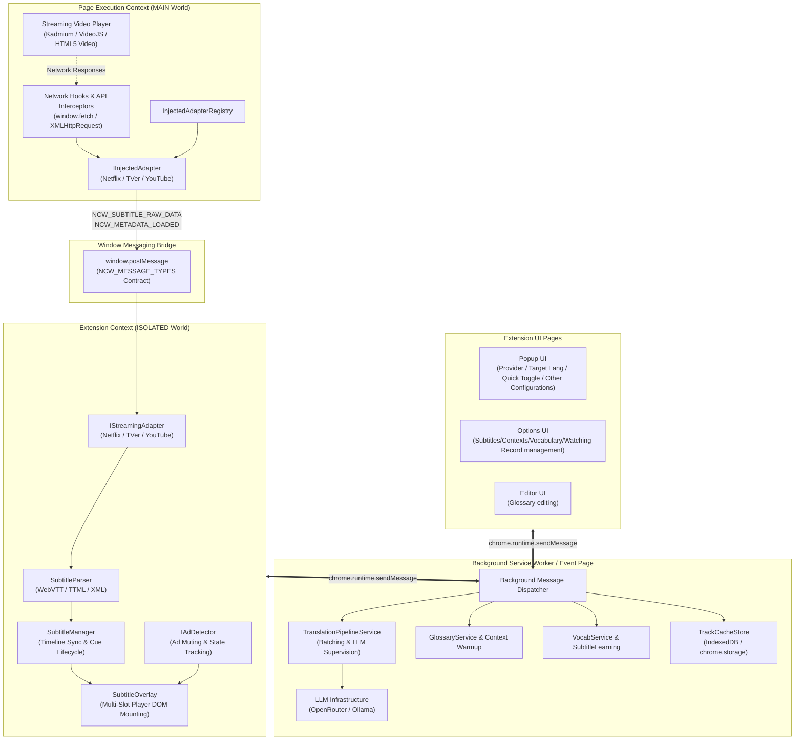
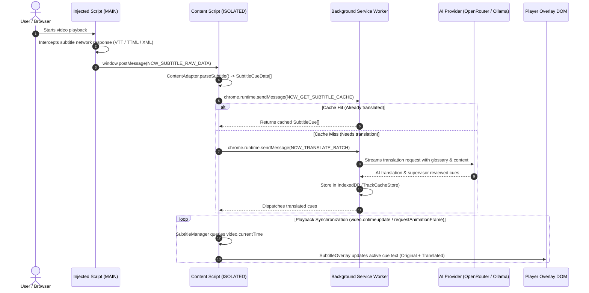
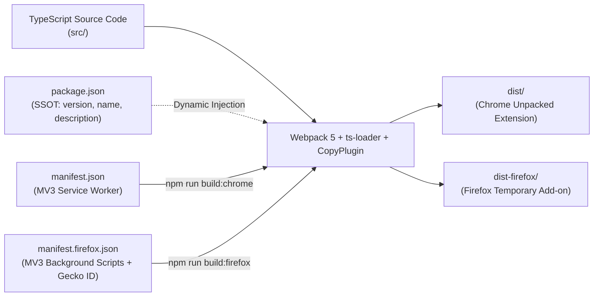

# CoWatcher Architecture Overview

> **CoWatcher** is a high-performance, modular browser extension designed for dual subtitles, real-time AI translation, vocabulary learning, and language immersion across modern streaming platforms (Netflix, TVer, YouTube, Disney+, etc.).
> It natively targets **Chrome (Manifest V3)** and **Firefox (Manifest V3)** from a single, unified TypeScript codebase.

---

## 1. Core Engineering Tenets & Architectural Rules

### 1. Explicit over Implicit

- We discourage `any` or `object` but that doesn't mean you cannot use it. If possible, you should specify a carefully defined data type instead of some guessing about object, array, or whatever.
- If your data type is shared with more than one class, or in other words, if it is not some internal using only data type, you should define it in a domain dir in its related scope. The scopes means the root dir like `content`, `injected`, `background`, and so on. If such data type is shared across scopes, it should be defined under `shared`'s domain.

We don't want anyone to guess other's work or purpose. An explicit defined data type means an explicit function with explicit parameters and return types. It will make following development easier and more maintainable.

### 2. No Silent Fallbacks (Fail-Fast Principle)

In other languages, you might hear fallback as some advanced techniques, but it is not the case here. In js/ts, there are too many fallbacks including guessing a data type and write at least three fallbacks to handle it, which is just bullshit and meaningless! In our business logic(You can understand this as any codes excepts adapter related codes), fallback is discouraged! Just let this program crash and throw error! We prefer error message or stack trace to tell us which is wrong rather than silently handling it. You declare you only accept specific carefully defined data types, then, if your down-stream uses a wrong data type, just let them shoot their own feet!

ADAPTERs are exceptional. You can write as many fallback as you like for adapters as long as it works! But in practice, a carefully design is more important than fallbacks.

### 3. Strictly No Anemic DTOs

> [!IMPORTANT]
> **Data Transfer Objects (DTOs) are NOT allowed anywhere in this repository.**

Currently, we disallows any DTOs to exist in this project.

Indeed, we use message to communicate between different browser components, but those are all our own logic. We don't have split brain problem and should never have.

### 4. Platform Anti-Corruption Layer (ACL)

- Third-party streaming platforms (Netflix, TVer, YouTube, Disney+, etc.) have volatile DOMs and proprietary player engines.
- **Quarantine platform specifics**: Keep all proprietary APIs (Kadmium player, VideoJS, YouTube ytplayer), selectors, and raw subtitle format parsers inside `src/injected/infrastructure/adapters/<platform>/` and `src/content/infrastructure/adapters/<platform>/`. If you need new interface, define it in related adapter interfaces, just remember help existing adapters to implement it!
- The core domain (`SubtitleManager`, `SubtitleOverlay`, `TranslationPipelineService`) must stay completely platform-agnostic.

### 5. Packaging

- `package.json` is the sole authority for extension `version`, `displayName`, and `description`. Webpack injects these dynamically into both Chrome and Firefox manifests during compilation.

---

## 2. Multi-World System Topology

Browser extensions operate across isolated execution boundaries. CoWatcher partitions its responsibilities across three distinct execution contexts:



### Execution World Breakdown

| World / Boundary                                                         | Scope & Permissions                                                                                       | Core Responsibilities                                                                                                                                                                           |
| :----------------------------------------------------------------------- | :-------------------------------------------------------------------------------------------------------- | :---------------------------------------------------------------------------------------------------------------------------------------------------------------------------------------------- |
| **`injected/`**<br>_(Execution World: `MAIN`)_                           | Full access to webpage `window`, global variables, prototype monkey-patching. **No extension APIs.**      | Intercepts streaming manifest requests, raw subtitle downloads, and proprietary player APIs (Netflix Kadmium, YouTube player). Dispatches standardized event payloads via `window.postMessage`. |
| **`content/`**<br>_(Execution World: `ISOLATED`)_                        | Full DOM access; isolated JS sandbox; access to `chrome.storage` and `chrome.runtime`.                    | Receives bridge messages from `injected/`, normalizes subtitle cues, locates player presentation containers, renders custom bilingual overlays, manages playhead synchronization and ad hiding. |
| **`background/`**<br>_(Service Worker in Chrome, Event Page in Firefox)_ | Background script with full extension privileges, network capabilities, and persistent IndexedDB storage. | Coordinates the AI translation pipeline, streams LLM completions (OpenRouter / Ollama), manages terminology glossaries, context memory, and cached tracks.                                      |
| **`popup/`, `options/`, `editor/`**<br>_(Extension Pages)_               | Standard extension UI HTML/CSS/TS.                                                                        | Configuration, API key management, prompt engineering, vocabulary browsing, and manual track corrections.                                                                                       |

---

## 3. Domain-Driven Design (DDD) Layering

CoWatcher structures code strictly according to Domain-Driven Design principles:

```
src/
├── shared/                         # Shared kernel across all layers
│   ├── domain/
│   │   ├── constants/              # MessageTypes, SettingsDefaults, StorageKeys, StreamingPlatforms
│   │   ├── entities/               # SubtitleCue, SubtitleTrack, AiSubState, Context, WatchHistory
│   │   ├── value-objects/          # Language, CacheKey
│   │   └── repositories/           # Repository interfaces
│   ├── infrastructure/
│   │   ├── platform/               # BrowserPlatformFactory (Chrome vs Firefox API abstraction)
│   │   └── storage/                # BrowserStorageFactory (Local/Sync/IndexedDB storage abstraction)
│   └── utils/                      # Logger, i18n, hash utilities
│
├── injected/                       # MAIN World Script
│   ├── domain/                     # IInjectedAdapter, InjectedAdapterRegistry, message payload types
│   └── infrastructure/
│       ├── network/                # NetworkHook (fetch/XHR hooking), SubtitleStreamDetector
│       └── adapters/               # Platform implementations: netflix/, tver/, youtube/
│
├── content/                        # ISOLATED World Script
│   ├── domain/                     # IStreamingAdapter, StreamingAdapterRegistry, IAdDetector
│   ├── application/                # SubtitleManager, ContentMessageService, SubtitleParser
│   ├── infrastructure/
│   │   └── adapters/               # Platform implementations: netflix/, tver/, youtube/
│   └── presentation/               # SubtitleOverlay, DOM positioning, CSS styles
│
├── background/                     # Background Service Worker / Background Script
│   ├── domain/                     # Translation & LLM contracts, pipeline interfaces
│   ├── application/services/       # TranslationPipelineService, GlossaryService, VocabService, LlmService
│   ├── infrastructure/
│   │   ├── cache/                  # TrackCacheStore (IndexedDB), memory caches
│   │   ├── llm/                    # OpenRouterAdapter, OllamaAdapter
│   │   └── translation/            # Batch translators, supervisor reviewers
│   └── presentation/               # Runtime message routing and event dispatching
│
├── popup/                          # Extension popup UI
├── options/                        # Settings & preferences page
└── editor/                         # Subtitle & glossary editor
```

---

## 4. Subtitle Lifecycle & Data Flow



---

## 5. How to Add Support for a New Streaming Platform

Follow this strict step-by-step checklist to introduce support for a new streaming platform (e.g. `disney`, `hulu`, `crunchyroll`):

### Step 1: Register Platform Identifier

Add the platform identifier to [`src/shared/domain/constants/StreamingPlatforms.ts`](file:///home/tom/Documents/codes/javascript/cowatcher-extension-public/src/shared/domain/constants/StreamingPlatforms.ts):

```typescript
export const STREAMING_PLATFORMS = {
  NETFLIX: "netflix",
  TVER: "tver",
  YOUTUBE: "youtube",
  DISNEY: "disney", // Added
} as const;
```

### Step 2: Implement MAIN World Injected Adapter

Create `src/injected/infrastructure/adapters/<platform>/<Platform>InjectedAdapter.ts` implementing `IInjectedAdapter`:

- Check URL matching in `matches(url: string)`.
- Use `NetworkHook` to sniff subtitle URLs and API responses, or hook platform player globals.
- Emit `NCW_SUBTITLE_RAW_DATA`, `NCW_METADATA_LOADED`, and `NCW_EPISODE_CHANGED` via `window.postMessage`.
- Register the adapter in [`src/injected/injected.ts`](file:///home/tom/Documents/codes/javascript/cowatcher-extension-public/src/injected/injected.ts):

  ```typescript
  InjectedAdapterRegistry.register(new DisneyInjectedAdapter());
  ```

### Step 3: Implement ISOLATED World Content Adapter

Create `src/content/infrastructure/adapters/<platform>/<Platform>ContentAdapter.ts` implementing `IStreamingAdapter`:

- **`getVideoElement()`**: Return the active `<video>` element (or `null` if not found).
- **`getPlayerContainer()`**: Return the specific player container (e.g. `.video-player-container`).
  > [!IMPORTANT]
  > **NEVER return `document.body`**. If the container is not found, return `null`. Ensure the container has `position: relative` or `position: absolute`.
- **`parseSubtitle(rawText: string)`**: Convert raw platform subtitle data into normalized `SubtitleCueData[]`.
- Register the adapter in [`src/content/content.ts`](file:///home/tom/Documents/codes/javascript/cowatcher-extension-public/src/content/content.ts):

  ```typescript
  StreamingAdapterRegistry.register(new DisneyContentAdapter());
  ```

### Step 4: Update Manifest Permissions & Matches

Add the platform's URL patterns to both `manifest.json` (Chrome) and `manifest.firefox.json` (Firefox) under `content_scripts.matches` and `host_permissions`.

### Step 5: Verification & Quality Gate

Run type checking and verify builds for both targets:

```bash
npx tsc --noEmit
npm run build:all
```

---

## 6. Cross-Browser Build Architecture

CoWatcher compiles dual distribution builds from a single TypeScript source tree:



- **Chrome Target (`dist/`)**:
  - Uses `manifest.json`.
  - Service worker background: `"background": { "service_worker": "background/background.js" }`.
- **Firefox Target (`dist-firefox/`)**:
  - Uses `manifest.firefox.json`.
  - Event page background: `"background": { "scripts": ["background/background.js"] }`.
  - Includes `browser_specific_settings.gecko` with an explicit extension ID and minimum Firefox version.
- **Dynamic Manifest Sync**:
  `webpack.config.cjs` utilizes `copy-webpack-plugin` with a custom `transform` hook to guarantee that `version`, `displayName`, and `description` from `package.json` are automatically injected into both manifests upon build.
